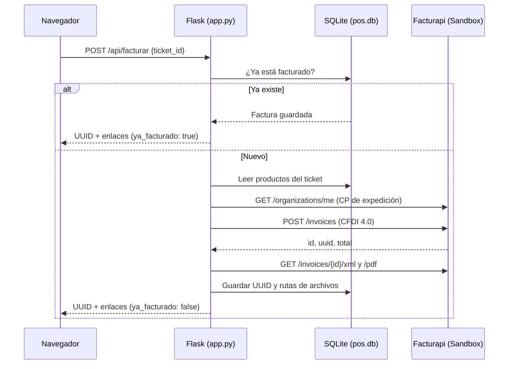
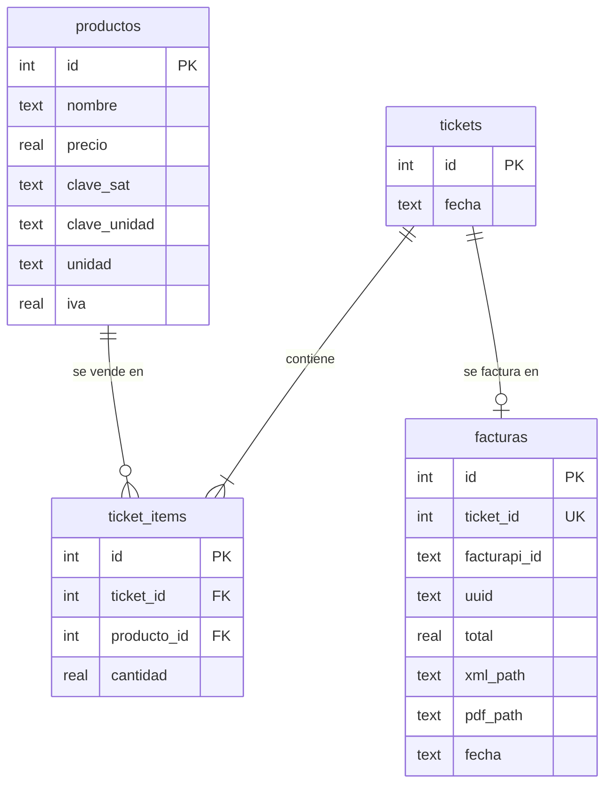

# 🧾 Factura CFDI Test

[](https://www.python.org/)
[](https://flask.palletsprojects.com/)
[](https://www.sqlite.org/)
[](https://www.sat.gob.mx/)
[](https://www.facturapi.io/)


Prototipo funcional (MVP) de facturación para un **Punto de Venta (POS)**. Recibe el ID de un ticket, arma la venta desde la base de datos, timbra un **CFDI 4.0** a través de [Facturapi](https://www.facturapi.io/) y guarda el **UUID**, el **XML** y el **PDF**.

> [!WARNING]
> Este proyecto usa **únicamente el ambiente de pruebas (Sandbox)** de Facturapi, con una `Test Secret Key` y el RFC genérico del SAT `AAA010101AAA`. Las facturas **no tienen validez fiscal**. No uses una llave `sk_live_...` sin antes revisar la sección [Pasar a producción](#-pasar-a-producción).

<table>
  <tr>
    <th align="center">🎫 Ticket</th>
    <th align="center">⚙️ Backend</th>
    <th align="center">📄 Resultado</th>
  </tr>
  <tr>
    <td align="center">Un ID numérico en un formulario web</td>
    <td align="center">Flask consulta SQLite, arma el payload CFDI 4.0 y lo envía a Facturapi</td>
    <td align="center">UUID + XML + PDF guardados y disponibles para descargar</td>
  </tr>
</table>

## 📑 Tabla de contenido

- [✨ Características](#-características)
- [🏗️ Arquitectura](#️-arquitectura)
- [🚀 Inicio rápido](#-inicio-rápido)
- [🔑 Configuración](#-configuración)
- [🔌 API](#-api)
- [🧮 Datos fiscales usados](#-datos-fiscales-usados)
- [🗄️ Base de datos](#️-base-de-datos)
- [📁 Estructura del proyecto](#-estructura-del-proyecto)
- [🛠️ Solución de problemas](#️-solución-de-problemas)
- [➡️ Pasar a producción](#-pasar-a-producción)
- [🗺️ Ideas a futuro](#️-ideas-a-futuro)

## ✨ Características

| | Función | Detalle |
|---|---|---|
| 🧾 | **Timbrado CFDI 4.0** | Tipo `Ingreso`, método `PUE`, forma de pago `01 - Efectivo`, moneda `MXN` |
| 👥 | **Receptor genérico** | `XAXX010101000` / `PUBLICO EN GENERAL` / régimen `616` / uso `S01` |
| 🌐 | **Factura global** | Incluye el nodo `global` (periodicidad diaria, mes y año actuales) que exige el SAT con RFC genérico |
| 💰 | **IVA incluido** | Los precios guardados ya incluyen IVA (`tax_included=True`) |
| ♻️ | **Idempotente** | Un ticket se factura una sola vez. Si lo repites, devuelve la factura existente |
| 💾 | **Archivos locales** | Descarga XML y PDF desde el backend y los guarda en `facturas/` |
| 🔒 | **Llave protegida** | La `sk_test_...` vive en `.env`; el frontend nunca la ve |
| 📍 | **CP automático** | Toma el código postal de expedición de tu organización en Facturapi |

## 🏗️ Arquitectura



**Stack:** Python · Flask · SQLite · HTML/JS/CSS vanilla · `requests` · `python-dotenv`

## 🚀 Inicio rápido

> [!IMPORTANT]
> Todo se ejecuta dentro de un entorno virtual (`.venv`). No instales dependencias en el Python global.

**Requisitos:** Python 3.10 o superior y una cuenta de [Facturapi](https://www.facturapi.io/) con organización de pruebas.

```powershell
# 1. Clona el repositorio y entra a la carpeta
git clone <url-del-repo>
cd Factura_CFDI_Test

# 2. Crea el entorno virtual e instala dependencias
python -m venv .venv
.\.venv\Scripts\python.exe -m pip install -r requirements.txt

# 3. Crea tu archivo .env (ver sección Configuración)
#    FACTURAPI_KEY=<TU_TEST_SECRET_KEY>

# 4. Inicia el servidor
.\.venv\Scripts\python.exe app.py
```

Abre **http://127.0.0.1:5000**, escribe `1` o `2` (tickets de ejemplo) y pulsa **Facturar**.

<details>
<summary>🐧 macOS / Linux</summary>

```bash
python3 -m venv .venv
.venv/bin/python -m pip install -r requirements.txt
.venv/bin/python app.py
```

</details>

La primera ejecución crea `pos.db` y siembra 3 productos y 2 tickets de ejemplo.

## 🔑 Configuración

Crea un archivo `.env` en la raíz del proyecto:

```ini
FACTURAPI_KEY=<TU_TEST_SECRET_KEY>
```

*(Nota: La llave de ejemplo anterior ha sido eliminada por seguridad)*

| Variable | Obligatoria | Descripción |
|---|---|---|
| `FACTURAPI_KEY` | ✅ | Test Secret Key de Facturapi (empieza con `sk_test_`) |

> [!CAUTION]
> `.env` está en `.gitignore`. **Nunca** subas tu llave al repositorio. Si la expones, regénerala desde el panel de Facturapi.

## 🔌 API

| Método | Ruta | Descripción |
|---|---|---|
| `GET` | `/` | Frontend (formulario de facturación) |
| `POST` | `/api/facturar` | Emite la factura de un ticket |
| `GET` | `/api/facturas` | Lista las facturas emitidas |
| `GET` | `/api/facturas/<ticket_id>/xml` | Descarga el XML |
| `GET` | `/api/facturas/<ticket_id>/pdf` | Descarga el PDF |

<details open>
<summary><b>POST /api/facturar</b></summary>

**Petición**

```json
{ "ticket_id": 1 }
```

**Respuesta `200`**

```json
{
  "ticket_id": 1,
  "uuid": "7c13371c-694c-4edb-80b1-0615e0eabebf",
  "total": 175.5,
  "xml_url": "/api/facturas/1/xml",
  "pdf_url": "/api/facturas/1/pdf",
  "ya_facturado": false
}
```

**Errores**

| Código | Causa |
|---|---|
| `400` | ID inválido o ticket sin productos |
| `404` | El ticket no existe |
| `500` | Falta `FACTURAPI_KEY` en `.env` |
| `502` | Facturapi rechazó la factura o no respondió (el detalle viene en `detalle`) |

</details>

<details>
<summary><b>Probar con PowerShell</b></summary>

```powershell
Invoke-RestMethod -Method Post -Uri http://127.0.0.1:5000/api/facturar `
  -ContentType application/json -Body '{"ticket_id":1}' | ConvertTo-Json
```

</details>

## 🧮 Datos fiscales usados

| Campo CFDI | Valor | Nota |
|---|---|---|
| Tipo | `I` (Ingreso) | |
| Método de pago | `PUE` | Pago en una sola exhibición |
| Forma de pago | `01` | Efectivo |
| Uso CFDI | `S01` | Sin efectos fiscales. El SAT **no acepta `G03`** con el RFC genérico |
| Receptor | `XAXX010101000` | `PUBLICO EN GENERAL`, régimen `616` |
| CP del receptor | CP de expedición | Se consulta a Facturapi |
| Factura global | Periodicidad `day` | Mes y año actuales |
| IVA | 16 % | Incluido en el precio |

<details>
<summary>📦 Productos de ejemplo sembrados</summary>

| Producto | Precio (IVA incl.) | Clave SAT | Unidad |
|---|---|---|---|
| Café americano | $45.00 | `90101501` | `E48` |
| Sándwich de jamón | $85.50 | `50192100` | `H87` |
| Botella de agua 600ml | $18.00 | `50202310` | `H87` |

| Ticket | Contenido | Total |
|---|---|---|
| `1` | 2 × Café + 1 × Sándwich | $175.50 |
| `2` | 3 × Agua + 1 × Café | $99.00 |

Las claves SAT son de ejemplo: cámbialas por las de tu catálogo real.

</details>

## 🗄️ Base de datos

SQLite (`pos.db`, se crea automáticamente).



## 📁 Estructura del proyecto

```text
Factura_CFDI_Test/
├── app.py                  # Backend Flask, acceso a SQLite e integración con Facturapi
├── static/
│   └── index.html          # Frontend (HTML/JS/CSS vanilla)
├── Certificados_Pruebas/   # Certificados CSD de prueba del SAT
├── facturas/               # XML y PDF generados (ignorado por git)
├── pos.db                  # Base de datos SQLite (ignorada por git)
├── requirements.txt        # Dependencias
├── .env                    # Tu llave de Facturapi (ignorado por git)
└── README.md
```

## 🛠️ Solución de problemas

<details>
<summary><b>Facturapi rechazó la factura (502)</b></summary>

Revisa el campo `detalle` de la respuesta. Causas comunes:

- La organización de pruebas no tiene los certificados CSD cargados.
- La clave de producto/servicio o de unidad no existe en el catálogo del SAT.
- El código postal del receptor no coincide con el de expedición.

</details>

<details>
<summary><b>"Falta FACTURAPI_KEY en .env"</b></summary>

Verifica que `.env` esté en la raíz, junto a `app.py`, y que la variable se llame exactamente `FACTURAPI_KEY`. Reinicia el servidor después de editarlo.

</details>

<details>
<summary><b>No puedo mover o borrar <code>pos.db</code> en Windows</b></summary>

El servidor Flask mantiene el archivo abierto. Detenlo con `Ctrl+C` antes de moverlo. Con `debug=True` puede quedar un proceso hijo del reloader: ciérralo también.

</details>

<details>
<summary><b>Quiero volver a facturar un ticket</b></summary>

Cada ticket se factura una sola vez. Para pruebas, borra `pos.db` (se regenera con los datos de ejemplo) y los archivos de `facturas/`.

</details>

## ➡️ Pasar a producción

Este MVP está pensado para pruebas. Antes de timbrar facturas reales:

- [ ] Cambiar a la `Live Secret Key` y cargar los **CSD reales** de tu negocio.
- [ ] Sustituir el receptor genérico por **datos reales del cliente** cuando lo solicite.
- [ ] Reemplazar productos y claves SAT de ejemplo por tu catálogo.
- [ ] Desactivar `debug=True` y servir con un servidor WSGI (por ejemplo, `waitress` o `gunicorn`).
- [ ] Agregar autenticación a los endpoints y controles de acceso a `facturas/`.
- [ ] Respaldar `pos.db` y `facturas/`: el XML timbrado es un documento fiscal.

## 🗺️ Ideas a futuro

- [ ] Cancelación de facturas (motivo `02`, por ejemplo).
- [ ] Receptor con datos reales (RFC, razón social, régimen) y uso `G03`.
- [ ] Listado de facturas emitidas en el frontend.
- [ ] Tickets con descuentos, IEPS u otros impuestos.
- [ ] Envío de la factura por correo.
- [ ] Pruebas automatizadas con Facturapi simulado.

## ⚠️ Aviso

Proyecto educativo y de prueba. No constituye asesoría fiscal. Consulta a tu contador antes de facturar en producción.